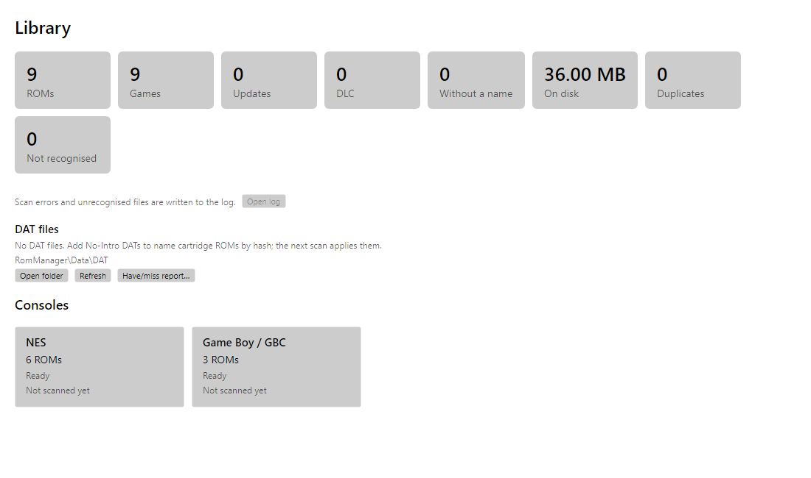
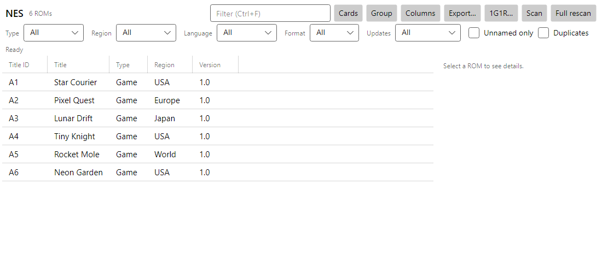
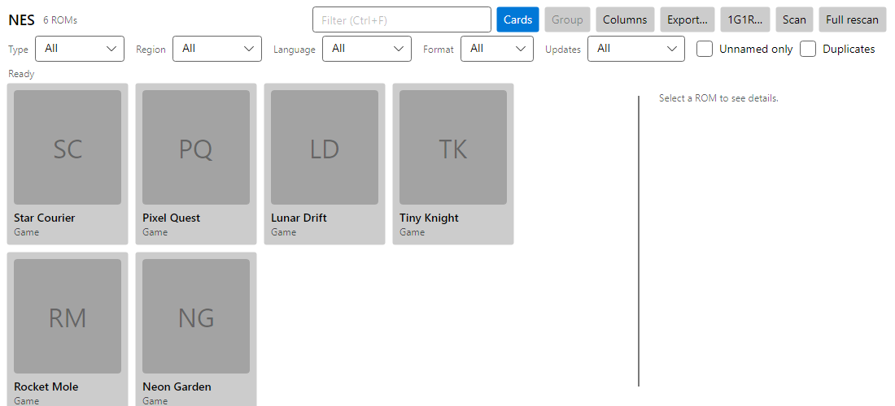
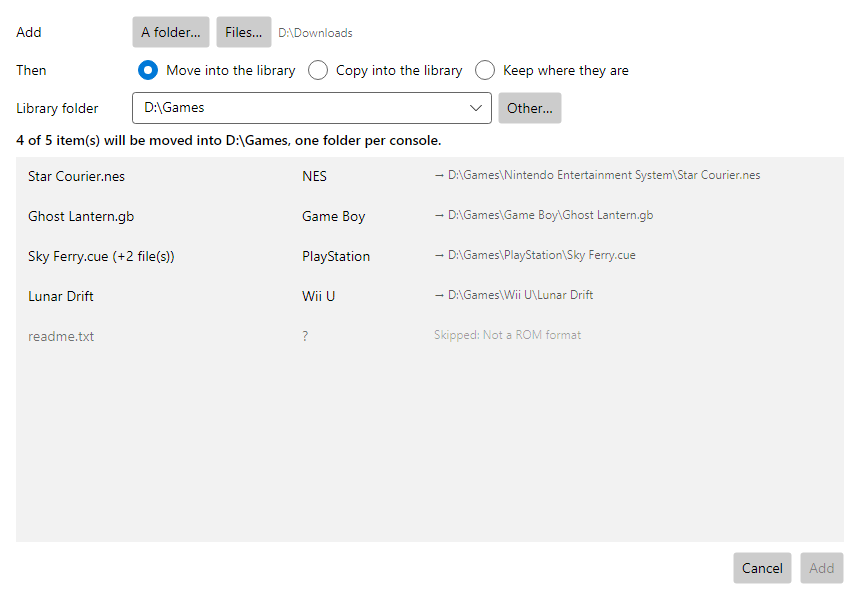
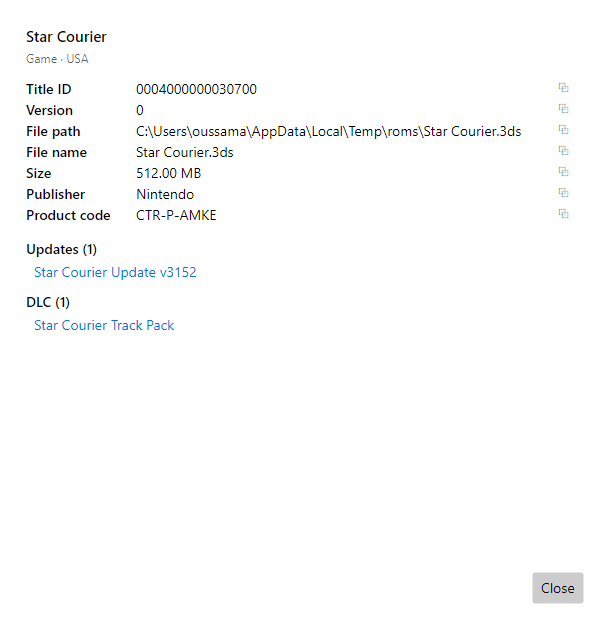

# RomManager

A desktop ROM library manager for Windows, Linux and macOS (.NET 10 + Avalonia). Point it at one
folder per console and it reads each file's header or container to find the title ID, name, version,
region and icon, keeps the library in a local database, and lets you rename, move, de-duplicate and
hash files.



| Table | Cards |
|---|---|
|  |  |
| **Add to library** | **Properties** |
|  |  |

Screenshots are rendered by the headless UI tests with sample data (`SCREENSHOTS=1 dotnet test`).

## Features

- **Library**: incremental scans (only new or changed files are parsed), a file watcher per ROM folder,
  progress and cancel, a list of unrecognised files with the reason each one failed.
- **Dashboard**: totals, duplicates, missing updates, unrecognised files and per-console scan status.
- **Browse**: table or cover cards, an "All consoles" view, grouping of updates/DLC under their game,
  filters (type, region, language, format, has/no update, duplicates, unnamed) and search.
- **Organise**: rename with a preview of old → new names, move with a preview, delete, hash
  (CRC32/MD5/SHA1), duplicate detection, 1G1R (keep one version per game by region priority), one folder per
  game (with its updates and DLC), verify a selection against DATs; operations run in a queue with cancel and
  undo (undo survives a restart).
- **Library folders**: folders the app organises with one sub-folder per console. File → Add to library moves
  or copies files or a folder into them (or keeps them in place), showing where each file goes first.
- **Save data**: finds a game's saves next to the ROM and in common emulators' folders (Citra/Azahar, Yuzu-based,
  PPSSPP, Dolphin, RPCS3, Vita3K), opens them, backs them up to a zip and restores them.
- **Convert**: CHD, RVZ, CSO and NSZ through chdman, DolphinTool, maxcso or nsz that you install
  yourself (Settings → Conversion tools); originals are kept.
- **Identify**: No-Intro DAT matching for cartridge consoles (by hash), title databases for Switch,
  3DS and Wii U, libretro box art for DAT-matched games, embedded icons and banners.
- **Missing updates**: Switch (titledb `versions.json`) and, opt-in, PS4 (Sony's update server).
  **Switch missing DLC** from the titledb title database.
- **Plugins**: add context-menu actions, save metadata to the library (undoable) and hear about scans and
  file changes; each plugin declares its permissions, needs your approval before it runs, and only gets
  network, files outside its folder, processes, the database and library metadata when it declared them.
  Shipped with the app: RAWG and IGDB metadata, GameTDB box art, web search (web, YouTube, GameFAQs) and
  playlists (RetroArch `.lpl`, EmulationStation `gamelist.xml`). See [SamplePlugin](SamplePlugin/README.md).

## Supported formats

| Console | Formats | Notes |
|---|---|---|
| Nintendo Switch | nsp, nsz, xci | Full metadata needs your `prod.keys`/`title.keys`; a header scan works without them. XCI untested |
| Nintendo 3DS | cia, 3ds/cci, cxi | Encrypted cartridge dumps give the title ID; names come from the title DB |
| Nintendo DS | nds | Banner title and icon |
| Wii U | wux, wud, tmd, folders | Title ID/version without keys; names from the title DB |
| Wii / GameCube | wbfs, wad, iso, gcm, ciso, rvz, wia | |
| GB / GBC / GBA / NES / SNES / N64 | header formats | Names from No-Intro DATs you add |
| Mega Drive, Master System, Game Gear, PC Engine | header formats | Names from No-Intro DATs you add |
| PlayStation | cue/bin, iso, chd, pbp | Serial from SYSTEM.CNF |
| PlayStation 2 | iso, cso, zso, chd | ISO9660 and UDF |
| PSP | iso, cso, pbp, pkg | Icon from ICON0.PNG |
| PS3 / PS Vita | pkg, folders, vpk | |
| PlayStation 4 | pkg | Title, version, icon and pictures |
| Dreamcast | gdi, chd | |
| Xbox / Xbox 360 | iso, xbe, xex | Xbox 360 names and icons need a user-supplied `xextool.exe` |

## Install

From the releases page:

- **Windows**: `RomManager-win-Setup.exe` (installs per user, updates itself) or `RomManager-win-Portable.zip`.
- **Linux**: the `.AppImage`. **macOS**: the `.pkg`.

Help → Check for app updates installs newer releases; Settings can also check at startup (off by default).
Builds are not code-signed yet, so Windows SmartScreen and macOS Gatekeeper will warn on first start.

To build from source you need the .NET 10 SDK:

```sh
dotnet run --project AvaloniaApplication1/AvaloniaUI.Desktop
```

## Setup

1. On first start, the setup wizard asks for your ROM folders. You can also drop a folder onto the
   window; RomManager guesses the console from the files. A console can have several folders.
2. **Switch keys** (optional, for full Switch metadata): put `prod.keys` and `title.keys` in
   `%USERPROFILE%\.switch\` (Windows) or `~/.switch/`. Settings shows whether they were found but never
   displays key values.
3. **Title databases** (optional): Settings → "Download title databases" fetches the Switch and Wii U
   title lists and the Switch `versions.json`.
4. **DATs** (optional): copy No-Intro DAT files into the DAT folder (Settings → Open DAT folder). They are
   applied on the next scan. Redump DATs for PlayStation, PS2, PSP, GameCube, Wii and Dreamcast match disc
   images when Settings → "Hash disc images" is on (slow on the first scan; results are cached).

Data (database, cache, logs) goes to `%AppData%/GeneralRomManager` unless `GlobalPaths.BaseDirectory` is set.
Your choices are saved to `settings.json` in the same folder (or next to the executable, if one is there).
Developers can keep personal paths in `AvaloniaApplication1/AvaloniaUI/config.local.json` (git-ignored).

## Documentation

- [Architecture](docs/ARCHITECTURE.md)
- [Roadmap](docs/ROADMAP.md)
- [Design decisions](docs/decisions/)

## Legal

RomManager does not include or download games, keys or firmware. Use it only with files you own.
